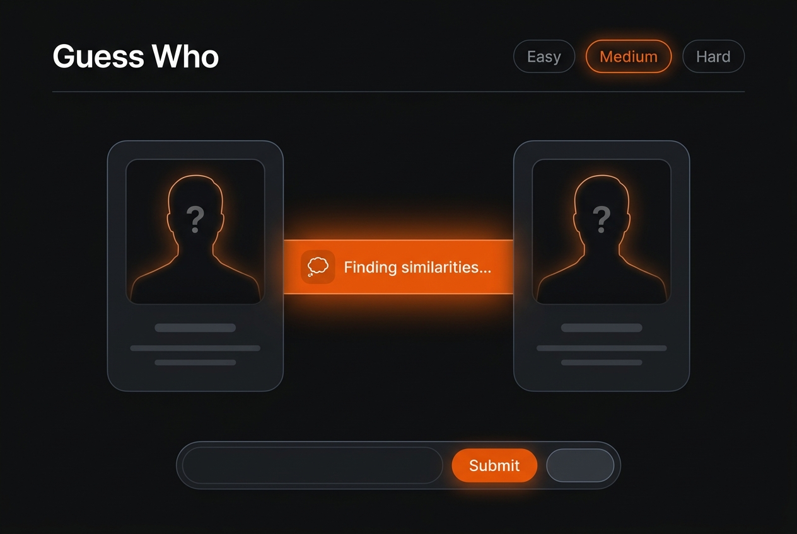

# Guess Who 🎭



An AI-powered pop-culture character guessing game featuring **Main Mode (2+ Player Deep-Lore Similarities)** and **Solo 20-Questions Mode** against an intelligent AI judge.

Live: **[https://guesswho.gian.ink](https://guesswho.gian.ink)**

---

## 🌟 Game Modes

### 👥 1. Main Mode (2+ Players Deep-Lore Similarity)
- **Unified Scalable Roster (2 to Any Number of Players)**:
  - Players secretly lock in characters one by one.
  - On Player 2's step, choose either instant play (`🚀 Lock In & Play (2 Players)`) or seamlessly add more players (`➕ Add Player 3`).
  - Supports unlimited players ($N \ge 2$).
- **Absolute Best Clue Selection (No Levels)**:
  - Selects the single absolute best canonical lore hint without artificial difficulty levels.
  - For 2 players: 1 deep, surprising in-universe connection.
  - For 3+ players: 1 universal clue (if genuinely interesting) or up to $\lfloor N/2 \rfloor$ specific subset clues (`"Two of your characters..."`, `"All of you..."`, etc.).
- **Full Player Coverage Guarantee**: Every player's character is guaranteed to have at least one hint connected to them.
- **Anti-Vague Lore Filtering**: Strictly filters out generic, boring trivialities such as gender (`"both are male/female"`), generic combat (`"you all fight somebody/enemies"`), or obvious human baselines.
- **Fact-Checker / Helper Bot**: Query the AI about any player's character during the game without spoilers.
- **Player Reveal Cards**: Individual reveal cards for each player plus an all-at-once "Reveal All" toggle.
- **Tip Quality Reporting**: Players can flag weird, inaccurate, or low-quality AI clues for review.

### 👤 2. Solo 20-Questions Mode
- **Category & Difficulty Selection**:
  - **Universes**: All Universes, Anime Only, Live Action Only, Western Animation Only, Gaming Only.
  - **Difficulties**:
    - **Easy**: Iconic pop-culture legends (e.g. Goku, Harry Potter, Spider-Man, Mario).
    - **Medium**: Well-known franchise characters (e.g. Levi Ackerman, Geralt of Rivia, Walter White).
    - **Hard**: Dynamically sampled random obscure characters pulled live from public databases (AniList GraphQL API and Fandom Wikis).
- **Strict Yes/No Enforcement**: Guarded by strict regex and AI validation to reject open-ended, non-binary questions and keep the 20-questions format fair.
- **Full Conversation History Memory**: The AI judge maintains context of all previous Q&As in the session to ensure consistent, non-contradictory answers.
- **Incomplete Input Detection**: Detects if a user accidentally sends a partial thought and prompts them to finish typing.
- **Shareable Game Links**: Generates a clean link to share your question count and results with friends.

---

## 🎨 UI & Design Highlights

- **Dark Mode Aesthetic**: Custom dark theme with deep slate backgrounds (`#121212`) and glowing energetic orange accents (`#ea580c`).
- **Responsive Layout**: Optimized 3-column desktop layout with collapsible side wings and stacked mobile views.

---

## 🏗️ Architecture & Tech Stack

- **Backend**: Node.js, Express
- **AI / LLM**: Ollama / Local & Cloud LLM pipelines with structured JSON prompting
- **Data Sources**:
  - Local database with 785+ balanced characters across anime, live action, comics, and gaming.
  - Live AniList GraphQL API integration for obscure anime/manga characters.
  - Live Fandom Wikis API integration for heroes, villains, and gaming lore.
- **Deployment**: Docker container, Nginx reverse proxy, automated SSL certificates.

---

## 🚀 Getting Started

### Prerequisites
- Node.js 20+
- Docker & Docker Compose (optional for containerized run)
- Running Ollama instance or configured LLM endpoint

### Local Installation

```bash
# Clone the repository
git clone https://github.com/GianUwU/guesswho.git
cd guesswho

# Install dependencies
npm install

# Start development server
npm run dev
# or
npm start
```

The application will be accessible at `http://localhost:3000`.

### Environment Configuration
Optional environment variables in `.env`:
```env
PORT=3000
OLLAMA_HOST=http://localhost:11434
OLLAMA_MODEL=llama3:latest
```

### Docker Deployment

```bash
# Build and run with Docker Compose
docker compose up -d --build
```

---

## 📄 License
MIT License. Open-source personal project operated by Gian at [gian.ink](https://gian.ink).
